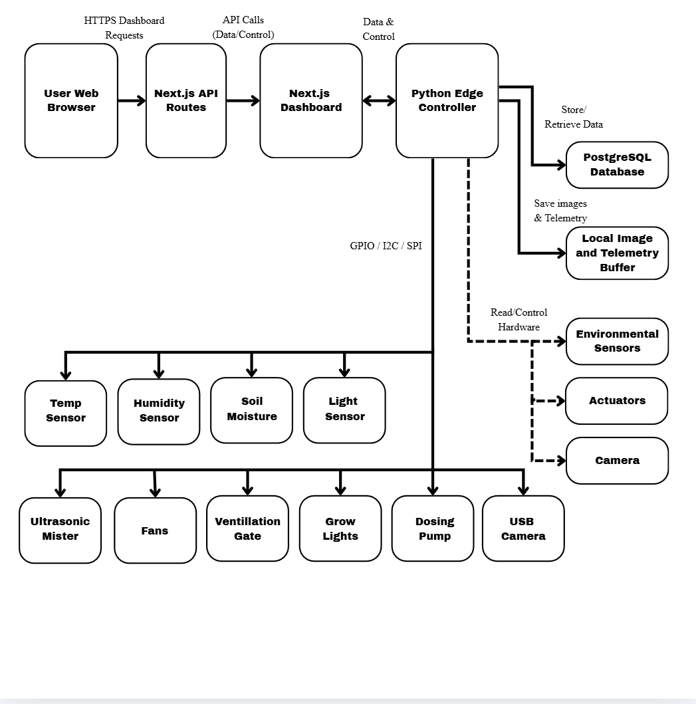

# PlantEra
A Smart Growing System for Plant Cuttings and Seedlings

# Project Overview
  PlantEra is an automated plant propagation system designed to help maintain suitable environmental conditions for plant cuttings and seedlings. It uses sensors and automated mechanisms to monitor and regulate humidity, temperature, soil moisture, and lighting.
The system integrates hardware components with a web-based platform, allowing users to monitor plant conditions, view live camera footage, manage settings, and access daily reports. PlantEra aims to reduce manual maintenance and improve the survival rate of plant cuttings and seedlings through automation.

# Features
1. Automated Humidity Control – Uses a mister and automatic ventilation to maintain humidity levels between 85% and 95%.
2. Temperature Monitoring – Monitors temperature and controls fans and ventilation to maintain suitable conditions.
3. Automatic Watering – Uses soil moisture sensors to determine when watering is needed.
4. Smart Lighting – Monitors light conditions and activates grow lights when additional lighting is needed.
5. Real-Time Monitoring – Displays humidity, temperature, soil moisture, and light readings through the website.
6. Live Camera Viewing – Allows users to remotely view the plants inside the propagation box.
7. Daily Reports – Records power consumption, water usage, system activities, and errors.
8. Device Management – Allows users to manage their devices and adjust environmental settings.
9. Offline Operation – Continues monitoring and controlling the growing environment even without an internet connection.

# System Architecture

# Hardware Requirements
- Orange Pi Pc as the main controller
- Temperature, humidity, soil moisture, and light sensors
- Ultrasonic mister, dosing pump, and fans
- Automated butterfly vent (3D-printed main body, flap, and rod)
- Servo motors for butterfly vent operation
- Grow lights and USB camera
- MicroSD card for local data storage
- Power supply modules, wiring, and electronic components

# Software Requirements
1. Operating System & Runtime
- Armbian Linux OS (Debian 13 on Orange Pi PC)
- Python 3.13 (Box backend, automation loop, and hardware services)
- Node.js (node:sqlite) (Offline local website test server)
2. Backend & API
- Flask + Waitress WSGI (Box local web server and JSON API)
- Cloudflare Pages Functions (Serverless web API)
3. Frontend & User Interface
- HTML5, CSS3, and JavaScript (ES Modules) (Box dashboard and public website)
- Three.js (3D interactive web visuals)
- GSAP & ScrollTrigger (Animations and scroll-based effects)
- Lenis (Smooth scrolling)
4. Database & Storage
- SQLite 3 (Local box database)
- Cloudflare D1 (Cloud SQLite database)
- Cloudflare R2 (Camera snapshot storage)
5. Hardware Communication & IoT
- Linux I²C (i2c-dev) (BH1750, AHT20, ADS1115, and PCA9685 hardware communication)
- Video4Linux2 (v4l2-ctl) (DV20 USB camera MJPEG capture service)
6. System Services & Networking
- systemd & udev (Isolated background services and device permission rules)
- NetworkManager & systemd-networkd (Local WPA2 Wi-Fi hotspot and LAN connectivity)

# How it Works
  PlantEra relies on an embedded hardware-to-software architecture designed to maintain an optimal propagation environment for delicate plant cuttings and seedlings:

1. Environmental Sensing: Integrated sensors continually measure four core environmental variables inside the propagation box: relative air humidity, ambient temperature, soil moisture percentage, and ambient light intensity.
2. Automated Regulation: The Orange Pi Zero 3 controller compares live sensor readings against target threshold profiles. When humidity drops or temperatures rise, the system triggers hardware actuators:

- Ultrasonic Mister: Disperses fine mist into the air to prevent leaf desiccation before roots develop.
- Airflow Fan & Vent Gate: Circulates air and vents excess heat to avoid stagnant humidity or thermal buildup.
- Grow Light & Dosing Pump: Regulates light cycles and soil hydration on automated schedules.

3. Visual Progress Tracking: An internal 1080p USB camera captures periodic snapshots of the propagation space, allowing users to observe root emergence (e.g., Root Watch tracking) without opening the sealed enclosure.

# Website Features

| Feature | Category | Description |
|---|---|---|
| **Offline Dashboard & Local Hosting** | System Access | A locally hosted web application running on the Orange Pi PC, accessible through the built-in PlantEra Wi-Fi hotspot or local Ethernet without requiring an internet connection. |
| **Live Environmental Telemetry** | Dashboard / Monitoring | Displays real-time temperature, relative humidity, soil moisture, light intensity, daily light hours, and water tank level through connected sensors, updated every 2 seconds. |
| **Interactive Environmental Charts** | Data Visualization | Presents historical temperature, humidity, soil moisture, and light readings through interactive charts with 24-hour and multi-day viewing options. |
| **Live USB Camera View** | Camera Monitoring | Provides a live 640×480 MJPEG camera stream for monitoring plants remotely through the local dashboard, with an on-demand Watch/Stop privacy control. |
| **Simulated & Live Sensor Toggle** | System Control | Allows users to switch between simulated demonstration readings and actual I²C sensor readings for testing and monitoring. |
| **Manual Equipment Controls** | Hardware Control | Allows users to manually test and control the Desk LED Lamp, Intake Fan, Ultrasonic Mister, and Peristaltic Water Pump through the dashboard using 5-second hardware test buttons. |
| **Automation Pause Control** | System Control | Provides a Pause Automation button that temporarily suspends automatic control rules for one hour during manual inspection or maintenance. |
| **Growth-Stage Presets** | Plant Management | Provides configurable environmental target ranges for three plant development stages: Propagation/Cuttings, Seedling, and Vegetative. |
| **Automatic Environmental Control** | Automation | Automatically manages connected equipment based on sensor readings and configured environmental targets, including overheat priority, dead-band hysteresis, and hardware safety limits. |
| **Historical Reports & Activity Log** | Reports / Documentation | Records environmental readings, automatic equipment actions, manual tests, and sensor events using a local SQLite database. |
| **System Health Monitoring** | System Administration | Displays Orange Pi PC system information, including CPU temperature, CPU load, RAM usage, SD card storage, network IP addresses, and system uptime. |
| **Owner Login & Security** | Security | Protects dashboard access through password hashing, brute-force login throttling, and session idle and expiration timeouts. |

# Scope and Limitations
1. Scope
- Target Application: Specially engineered for small-scale vegetative propagation (cuttings, seedlings, and fragile tropical plant species).
- Capacity: Standardized enclosure size designed to comfortably house 6 to 10 plant cuttings per unit to ensure adequate airflow and clear camera visibility.
- Hardware Integration: Configured to interface with an Orange Pi Zero 3 controller, 1080p USB camera, ultrasonic mister, dosing pump, ventilation fan, adjustable vent gate, grow lights, and multi-sensor array (temperature, humidity, soil moisture, light).
- Authentication & Database Architecture: Includes schema specifications (built with Drizzle ORM and PostgreSQL) supporting user account creation, session management, email verification, and client authentication (via Better Auth).
- Local Autonomy: Complete functional autonomy ensuring that misting schedules, ventilation pulses, and sensor triggers continue operating even during network outages.

2. Project Limitations
- No Online Payment Gateway: The website does not handle direct financial transactions or credit card processing; all orders are submitted as pre-order requests requiring direct team confirmation prior to fulfillment.
- Single-Unit Scale: Optimized for individual propagation boxes rather than high-volume commercial farm or industrial greenhouse scale.
- Hardware Dependency: Real-time telemetry monitoring and manual device toggles require physical connection to an active PlantEra hardware unit; frontend displays use simulated telemetry when un-paired.
- Camera Functionality: Camera view relies on still snapshot capture intervals rather than low-latency high-FPS video streaming.
  
# Project Team

| Name | Role |
|---|---|
| Jeremiah Sulit | Project Manager, Frontend Developer |
| Andrei Brian Mohammad Said | Backend Developer, Hardware/IoT Developer |
| Justine Babasa | Documentation Specialist, Quality Assurance Tester |
| Ranze Dimaala | Frontend Developer, UI/UX Designer |
| Aaron Aguda | Documentation Specialist |
| Trishtan De Roxas | Documentation Specialist, System Analyst |

